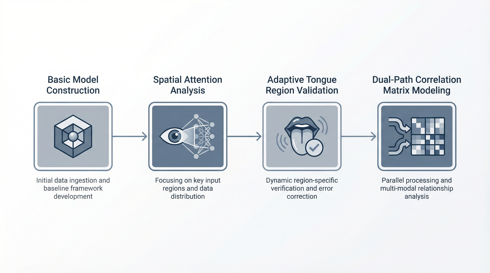

<div align="center">

# TCM-TongueNet


<p align="center">
  
</p>


An Interpretable Deep Learning Framework for Tongue Diagnosis: From Spatial Localization to Feature–Organ Association


</div>

---

## Overview


A PyTorch-based open-source toolkit for AI-assisted TCM tongue diagnosis, supporting dual-task decoupled modeling, Grad-CAM visualization, dual-matrix consistency validation, and TCM prior-guided attention learning.

---

## Project Structure

```
├── scripts/                    
│
├── split_dataset.py                               
├── train_5class_zangfu.py                      
├── inference.py                            
├── adaptive_segmentation.py                       
├── gradcam_visualization.py                       
├── region_quanification.py                       
├── train_13class_zangfu_tongue.py            
├── generate_all_maps.py                            
├── attention_matrix_from_image.py                  
├── attention_matrix_from_path.py                  
├── consistency_analysis_importance_matching.py     
└── consistency_analysis_weighted_fusion.py         

```

---

## Key Highlights

- **Dual-Task Decoupled Modeling**：Independent networks for five-viscera classification and multi-label feature learning effectively reduce feature interference and performance degradation.
- **Dual-Dimensional Interpretability**：Spatial localization via Grad-CAM and feature attribution via attention matrices reveal the underlying connections between tongue features and visceral abnormalities.
- **Data-Driven Adaptive Region Partitioning**：Tongue regions are statistically determined from large-sample attention distributions, reducing errors caused by fixed-ratio partitioning.
- **Dual-Matrix Rank Consistency Verification**：Cross-validation of two attention matrices via rank correlation significantly improves result reliability and reproducibility.
- **Quantitative TCM Prior Validation**：TCM priors serve as attention guidance without circular reasoning; core patterns are learned from data, ensuring scientific rigor.

---

## Installation

### Prerequisites
- Python 3.13.11
- CUDA 12.9 compatible GPU (recommended)

### Setup

```bash
# Clone repository
git clone https://github.com/3xiaoshayu/TCM-TongueNet.git
cd TCM-TongueNet

# Install dependencies
pip install torch torchvision opencv-python pandas numpy scipy matplotlib seaborn pillow scikit-learn pytorch-grad-cam
```

**Key Dependencies:**
```txt
torch>=1.12.0
torchvision>=0.13.0
opencv-python>=4.8.0
numpy>=1.24.0
pandas>=2.0.0
scipy>=1.10.0
matplotlib>=3.7.0
seaborn>=0.12.0
Pillow>=9.0.0
scikit-learn>=1.0.0
pytorch-grad-cam>=1.4.0
```

---

## Dataset

The tongue image datasets and clinical metadata used in this study were obtained from publicly available sources in previously published peer‑reviewed studies, following formal data access requests and ethical approval.  
All raw data are hosted and maintained by the original dataset owners.  
**Please refer to the official repository for access, license terms, and citation requirements:**  
👉 [https://github.com/tonguedx/tonguedx](https://github.com/tonguedx/tonguedx)

De‑identified processed data used in this work can be made available from the corresponding author upon reasonable request, subject to completion of a formal data sharing agreement.

---

## Usage Rules

This project is open-sourced under the MIT License. You can freely use, modify, and distribute the code for academic and non-commercial research purposes.

If you use this project in your research or publications, please cite this repository and the corresponding paper:
- Liu X, Wang J, Yu H, Xu P, Li B, Teng W, Han X*, Liu J*. An Interpretable Deep Learning Framework for Tongue Diagnosis: From Spatial Localization to Feature–Organ Association.

- Commercial use, unauthorized redistribution, and closed-source integration are not permitted without prior written permission from the authors.

- The authors are not responsible for any medical or clinical use of this project; it is designed for research only, not for clinical diagnosis or treatment.
---

## Acknowledgments

This work was supported by:
- **Natural Science Foundation of Shandong Province** (Grant No. ZR2024QF228, ZR2024QA176)
- **National Natural Science Foundation of China** (Grant No. 82301666)

---

## License

This project is licensed under the MIT License - see [LICENSE](LICENSE) for details.

---
